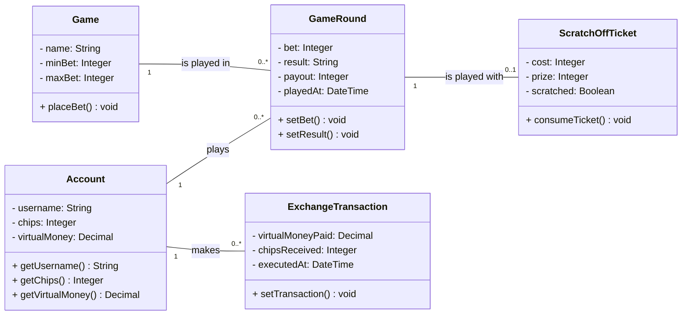

# CloverStack — Software Architecture Document

<!--
HOW TO USE THIS TEMPLATE
- Copy this file into the docs/ folder of your repository, next to SRS.md.
- Replace every [placeholder] in square brackets. Comments like this one are guidance: they
  are invisible on GitHub, and you may delete them once a section is done.
- Keep every heading and its number. Sections marked "Lecture 7" or later stay as they are
  until that lecture. If a section does not apply, write "Not applicable" and one sentence why.
- Every section you write names its author: in the "Author" line below its heading, or in
  the Author column of a table.
- Put every diagram into docs/diagrams/, the image together with its source file.
- Structure after the RUP template "Software Architecture Document":
  https://cin.ufpe.br/~if682/RUP/webtmpl/templates/a_and_d/rup_sad.htm
-->

| Team        | Version | Last change |
| ----------- | ------- | ----------- |
| CloverStack | 0.1     | 29.10.2026  |

The Git history of this file is the revision history.

## Table of contents

1. [Introduction](#1-introduction)
2. [Architectural representation](#2-architectural-representation)
3. [Architectural goals and constraints](#3-architectural-goals-and-constraints)
4. [Use-case view](#4-use-case-view)
5. [Logical view](#5-logical-view)
6. [Process view](#6-process-view)
7. [Deployment view](#7-deployment-view)
8. [Implementation view](#8-implementation-view)
9. [Data view](#9-data-view)
10. [Size and performance](#10-size-and-performance)
11. [Quality](#11-quality)

## 1 Introduction

### 1.1 Purpose

_Author: Miriam_

This document describes the architecture of CloverStack: the parts the application is made
of, how they are connected, and where they run. CloverStack is a casino-style web application in which players use virtual chips to play slot machine, roulette games and scratch-off tickets. This document is written for the development team, for the lecturer and for anyone interested.

### 1.2 Scope

_Author: Miriam_

This document covers the entire CloverStack application: the front end (TypeScript/React), which
runs in the player's browser; the back end (TypeScript/Node.js with Express); and the SQLite
database, as defined by the design constraints in [SRS 3.6](SRS.md#36-design-constraints). The only user is the player. The functional scope is described in [SRS 1.2](SRS.md#12-scope).

### 1.3 Definitions, acronyms and abbreviations

_Author: Miriam_

| Term | Meaning                             |
| ---- | ----------------------------------- |
| SAD  | Software Architecture Document      |
| SRS  | Software Requirements Specification |
| UCR  | Use-case realization                |

### 1.4 References

_Author: Miriam_

| Title        | Link                                                      |
| ------------ | --------------------------------------------------------- |
| SRS          | [SRS.md](SRS.md)                                          |
| Domain model | [domain_model.md](domain_model.md)                        |
| Repository   | [Repository](https://github.com/deadbeef-alo/CloverStack) |
| Board        | [Board](https://github.com/users/deadbeef-alo/projects/1) |

### 1.5 Overview

Section 2 names the views this document uses. Sections 3 to 11 describe the architecture view
by view, following the RUP template.

## 2 Architectural representation

_Author: Miriam_

| View                | Question it answers                       | Diagram                                 | Section |
| ------------------- | ----------------------------------------- | --------------------------------------- | ------- |
| Use-case view       | What does the system do, and for whom?    | Use case diagram, use-case realizations | 4       |
| Logical view        | Which classes, and how are they linked?   | Class diagrams                          | 5       |
| Process view        | What runs at the same time?               | Short description                       | 6       |
| Deployment view     | What runs where, and how is it connected? | Deployment diagram                      | 7       |
| Implementation view | Which parts is the code made of?          | Component diagram, package diagram      | 8       |

<!--
TASK 8 — two blocks for your SAD.md.
- Block 2.1: paste it into section 2, below the table of views.
- Block 8.2: paste it over section 8.2, which still says "Follows with Lectures 8 and 9".
- Replace every [placeholder] in square brackets. Comments like this one are invisible on GitHub;
  delete them once a part is done.
- Worked examples for both blocks: Task 8, and Lecture 8, slides 10 to 14 and 24 to 27.
-->

### 2.1 Architectural style

*Author: Adolfo*

**Main style:** Our backend is a layered monolith. There will be one main backend process (Monolith) running with Node.js. The browser and backend will communicate through the client over the REST API. The top levels folders will be also technical ordered: `routes`, `data`. Therefore, it is also layered.

**Why:** (1) **Four/three members with very limited time (C-02)**: We think a layered monolith is the simplest style between the alternatives. We also used it in the past with another project and that means we can use our personal experience on it.
(2) **We should not spend money on anything as we don't have budget (C-03)**: we could deploy the backend alone using platforms like Vercel, which is free.

**Rejected alternative:** There was no rejected alternative. We already used a layered monolith in a previous project and wanted to try it again for the current one.

<!--
TASK 9 — two blocks for your SAD.md.
- Block 2.2: paste it into section 2, below section 2.1 from Task 8.
- Block 11: paste it over section 11, which still says "Follows with Lectures 7 to 9".
- Replace every [placeholder] in square brackets. Comments like this one are invisible on GitHub;
  delete them once a part is done.
- Worked examples for both blocks: Task 9, and Lecture 9, slides 13 to 20 and 24 to 28.
-->

### 2.2 Architecture decisions

*Author: [first name]*

<!-- One row per ADR in docs/decisions/. An accepted ADR is not rewritten: a new decision gets a
     new ADR, and the old one gets the status "superseded by ADR-xx". -->

| ADR    | Decision                                                  | Status     | Date         |
| ------ | --------------------------------------------------------- | ---------- | ------------ |
| ADR-01 | [[short title]](decisions/ADR-01_[short-title].md)         | [accepted] | [dd.mm.yyyy] |

## 3 Architectural goals and constraints

Section 3 lists the requirements that shape our architecture: our quality goals as scenarios,
rated by business value and technical risk, and the constraints we have to design around. How the
architecture reaches each scenario follows in section 11.

### 3.1 Quality goals

_Author: Adolfo, Miriam_

<!-- The utility tree as a table. One row per scenario. Value and risk: H, M or L.
     The short form: stimulus → response measure. -->

| ID    | Quality   | Refinement   | Scenario, short                                                                                              | Value | Risk | Author       |
| ----- | --------- | ------------ | ------------------------------------------------------------------------------------------------------------ | :---: | :--: | ------------ |
| QS-01 | Usability | Learnability | A first-time player opens a game mode → 9 of 10 test users play a full round of that game after the tutorial |   M   |  L   | Miriam       |
| QS-02 | Reliability | Consistency and recovery | A player places a bet → 0 lost or duplicated transactions even when error | H | H | Adam |
| QS-03 | Supportability | Compatibility | Access to any function of the game → One test per browser without any issue |  M  | M | Adolfo |

#### QS-01 Tutorial for the games

| QS-01 Tutorial for the games | _Author: Miriam_ · Refines NFR-U-01                                                                           |
| ---------------------------- | ------------------------------------------------------------------------------------------------------------- |
| Source                       | A first-time player who has never used CloverStack or never played any of the games.                          |
| Stimulus                     | Open a game mode (slot machine, roulette or scratch-off ticket)                                               |
| Artifact                     | Frontend (available with an extra button in each game side)                                                   |
| Environment                  | Normal operation                                                                                              |
| Response                     | Shows a short tutorial that explains the basics of current game                                               |
| Response measure             | 9 of 10 test users who did not know the game before, get how it works after the tutorial and can play a round |

Business value M: CloverStack is built for entertainment, so players who do not understand a game leave, but casino fans already know the basic rules of most games.

Technical risk L: the tutorial is static content inside the frontend, so no other component is involved.

#### QS-02 Consistent Data Storage

| QS-02 Consistent Data Storage | _Author: Adam_ · Refines NFR-R-01                                                    |
| ----------------------------- | ------------------------------------------------------------------------------------ |
| Source                        | System, Player                                                                       |
| Stimulus                      | A Player places a bet                                                                |
| Artifact                      | Backend, DataBase                                                                    |
| Environment                   | Normal operation                                                                     |
| Response                      | The system needs to store data consistently                                          |
| Response measure              | 0 lost or duplicated transactions and 100% data consistency after system recovery.   |

Business value H: Data consistency is critical because losing or corrupting player transactions can lead to incorrect game results.

Technical risk H: Ensuring data consistency during unexpected system crashes is technically challenging because incomplete transactions could result in lost, duplicated or corrupted data.

#### QS-03 Browser compatibility

| QS-03 Browser compatibility | _Author: Adolfo_ · Refines NFR-S-01      |
| --------------------------- | ---------------------------------------- |
| Source                      | A player                                 |
| Stimulus                    | Accesses to any function of the game     |
| Artifact                    | The whole frontend                       |
| Environment                 | Normal operation                         |
| Response                    | Runs without bugs related to the browser |
| Response measure            | One test per browser without any issues  |

Business value M: If the application isn't compatible in their favorite browser, they may try to avoid using it instead of looking for a replacement.

Technical risk M: We could do it manually or automatize it with tools like Playwright.

### 3.2 Constraints

_Author: Adolfo_

| ID   | Kind           | Constraint                                               | What it means for our architecture |
| ---- | -------------- | -------------------------------------------------------- | ---------------------------------- |
| C-01 | Technical      | Frontend and backend uses TypeScript. SQLite DB as database [SRS 3.6](SRS.md#36-design-constraints) | One language on both sides. But Backend will use Express and Node.js. |
| C-02 | Organizational | Four/three members with very limited time | We will ensure the components are of an acceptable quality, nothing more. |
| C-03 | Economic | We should not spend money on anything as we don't have budget | Only free tier platforms will be used |

## 4 Use-case view

_Author: Adolfo_

The use case diagram of the whole application is in [SRS 2.2](SRS.md#22-use-case-diagram). The
use cases most important for the architecture are: UC-01, UC-02, UC-03, UC-04 and UC-05.

### 4.1 Use-case realizations

| Use case                                                                     | Realization                                                    | Author |
| ---------------------------------------------------------------------------- | -------------------------------------------------------------- | ------ |
| [UC-01 View account balance](use_cases/UC-01_View_account_balance.md)        | [UCR-01](use_case_realizations/UCR-01_view_account_balance.md) | Adolfo |
| [UC-02 Exchange Virtual Money for Chips](use_cases/UC-02_ExchangeMoney.md)   | [UCR-02](use_case_realizations/UCR-02_Exchange_Money.md)       | Adam   |
| [UC-03 Play slot machine](use_cases/UC-03_play-slot-machine.md)              | [UCR-03](use_case_realizations/UCR-03_play-slot-machine.md)    | Miriam |
| [UC-04 Play roulette](use_cases/UC-04_Play_roulette.md)                      | [UCR-04](use_case_realizations/UCR-04_play_roulette.md)        | Adolfo |
| [UC-05 Play Scratch-Off Tickets](use_cases/UC-05_play_Scratch_off_Ticket.md) | [UCR-05](use_case_realizations/UCR-05_Scratch_off_Ticket.md)   | Adam   |

## 5 Logical view

### 5.1 Overview

_Author: Adolfo_

The domain model is in [domain_model.md](domain_model.md).

### 5.2 Architecturally significant design packages

n/a

<!-- Optional for now. Link the design classes of your realizations (UCR section 2.5) or describe
     your most important packages in one sentence each. -->

## 6 Process view

n/a

<!-- Optional for now. One or two sentences: which processes run, e.g., the frontend in the
     browser, the backend, the database — and anything that runs in the background, such as a
     scheduled job. -->

## 7 Deployment view

_Author: Adam_

<!-- One UML deployment diagram: nodes (devices, execution environments), the artifacts that
     run on them, and the communication paths with their protocol. Draw the setup you plan for
     your final demo — or the one you use today, and say which. -->

| Node             | What runs there                                                    | Connected to                                           |
| ---------------- | ------------------------------------------------------------------ | ------------------------------------------------------ |
| Client (browser) | Frontend (React)                                                   | Server: HTTPS (REST API)                               |
| Server           | Backend API (Express), Game Services, Account Service, Persistence | Client (browser): HTTPS; Database: database connection |
| Database server  | Database                                                           | Server: database connection                            |

## 8 Implementation view

### 8.1 Overview

_Author: Adam_

| Component             | Responsibility                                                                   | Classes (Task 5)                    |
| --------------------- | -------------------------------------------------------------------------------- | ----------------------------------- |
| Frontend (React)      | Displays the game and account views and sends user actions to the backend        | [GameView, LoginForm]               |
| Backend API (Express) | Provides the REST API, validates requests and forwards them to the game services | [GameController, AccountController] |
| Game Services         | Implements the game logic and game operations                                    | [GameService, Game, Player]         |
| Account Service       | Manages accounts, including registration, login and account data                 | [AccountService, Account]           |
| Persistence           | Provides data access and stores and loads data from the database                 | [AccountRepository, GameRepository] |
| Database              | Stores the persistent data                                                       | –                                   |

### 8.2 Layers

*Author: [first name]*

<!-- One row per layer of your backend. A modular monolith: the layers inside one module,
     and your modules in the sentence below the table. A package diagram is welcome, not required. -->

| Layer         | Folder         | Contains              | May use               |
| ------------- | -------------- | --------------------- | --------------------- |
| [Web]         | `[src/web]`    | [routes, validation]  | [core]                |
| [Core]        | `[src/core]`   | [services, domain]    | [nothing below it, or only its own interfaces] |
| [Persistence] | `[src/db]`     | [repositories, SQL]   | [the database]        |

[Our modules are …, and they talk to each other through … — or delete this line if you have no
modules.]

<!-- Follow one use case through your code and check every import against the table.
     A shortcut you found is a result, not a failure: name the file and the line. -->

**Checked in the code.** We followed [UC-xx name]: `[file]` → `[file]` → `[file]`. [The rule
holds. / We found one shortcut: `[file]` imports `[what]` directly (line [n]). It is on our
board.]

## 9 Data view

<!-- Optional for now. Later: your database schema or ER model, derived from your domain model. -->

_Follows later._

## 10 Size and performance

<!-- Lecture 7. The numbers that shape your architecture, e.g., expected users and data, and
     your performance requirements from SRS 3.4. Leave this section as it is until then. -->

_Follows with Lecture 7._

## 11 Quality

*Author: [first name]*

<!-- One row per scenario from section 3.1. One or two tactics per scenario.
     Where: a component from 8.1 or a layer from 8.2. Status: in place, planned or not planned.
     Price: one short phrase — every tactic costs something. Decision: the ADR, if there is one. -->

How our architecture reaches the scenarios of section 3.1:

| Scenario      | Tactics   | Where       | Status   | Price   | Decision |
| ------------- | --------- | ----------- | -------- | ------- | -------- |
| QS-01 [name]  | [tactic]  | [component] | [status] | [price] | [— or ADR-xx] |
| QS-02 [name]  | [tactic]  | [component] | [status] | [price] | [— or ADR-xx] |
| QS-03 [name]  | [tactic]  | [component] | [status] | [price] | [— or ADR-xx] |

[Two or three sentences on your highest-rated scenario: why these tactics, and which alternative
you did not take. If a tactic is "not planned", say why in one sentence.]
