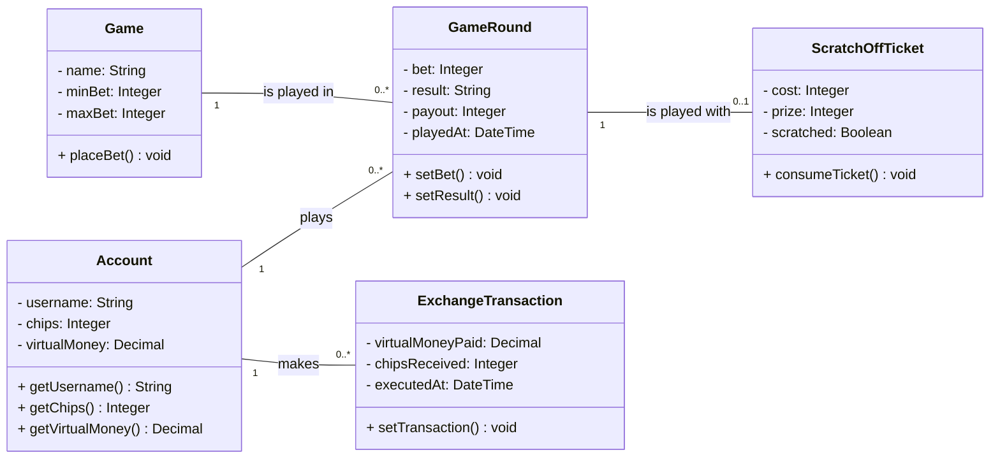

# CloverStack — Software Architecture Document

<!--
HOW TO USE THIS TEMPLATE
- Copy this file into the docs/ folder of your repository, next to SRS.md.
- Replace every [placeholder] in square brackets. Comments like this one are guidance: they
  are invisible on GitHub, and you may delete them once a section is done.
- Keep every heading and its number. Sections marked "Lecture 7" or later stay as they are
  until that lecture. If a section does not apply, write "Not applicable" and one sentence why.
- Every section you write names its author: in the "Author" line below its heading, or in
  the Author column of a table.
- Put every diagram into docs/diagrams/, the image together with its source file.
- Structure after the RUP template "Software Architecture Document":
  https://cin.ufpe.br/~if682/RUP/webtmpl/templates/a_and_d/rup_sad.htm
-->

| Team        | Version | Last change |
| ----------- | ------- | ----------- |
| CloverStack | 0.1     | 29.10.2026  |

The Git history of this file is the revision history.

## Table of contents

1. [Introduction](#1-introduction)
2. [Architectural representation](#2-architectural-representation)
3. [Architectural goals and constraints](#3-architectural-goals-and-constraints)
4. [Use-case view](#4-use-case-view)
5. [Logical view](#5-logical-view)
6. [Process view](#6-process-view)
7. [Deployment view](#7-deployment-view)
8. [Implementation view](#8-implementation-view)
9. [Data view](#9-data-view)
10. [Size and performance](#10-size-and-performance)
11. [Quality](#11-quality)

## 1 Introduction

### 1.1 Purpose

_Author: Miriam_

This document describes the architecture of CloverStack: the parts the application is made
of, how they are connected, and where they run. CloverStack is a casino-style web application in which players use virtual chips to play slot machine, roulette games and scratch-off tickets. This document is written for the development team, for the lecturer and for anyone interested.

### 1.2 Scope

_Author: Miriam_

This document covers the entire CloverStack application: the front end (TypeScript/React), which
runs in the player's browser; the back end (TypeScript/Node.js with Express); and the SQLite
database, as defined by the design constraints in [SRS 3.6](SRS.md#36-design-constraints). The only user is the player. The functional scope is described in [SRS 1.2](SRS.md#12-scope).

### 1.3 Definitions, acronyms and abbreviations

_Author: Miriam_

| Term | Meaning                             |
| ---- | ----------------------------------- |
| SAD  | Software Architecture Document      |
| SRS  | Software Requirements Specification |
| UCR  | Use-case realization                |

### 1.4 References

_Author: Miriam_

| Title        | Link                                                      |
| ------------ | --------------------------------------------------------- |
| SRS          | [SRS.md](SRS.md)                                          |
| Domain model | [domain_model.md](domain_model.md)                        |
| Repository   | [Repository](https://github.com/deadbeef-alo/CloverStack) |
| Board        | [Board](https://github.com/users/deadbeef-alo/projects/1) |

### 1.5 Overview

Section 2 names the views this document uses. Sections 3 to 11 describe the architecture view
by view, following the RUP template.

## 2 Architectural representation

_Author: Miriam_

<!-- Which views you use and which diagram shows each. The table is prefilled with the views of
     Lecture 6 — adjust it if you add or drop a view. Later lectures add your architectural
     style and your architecture decisions here. -->

| View                | Question it answers                       | Diagram                                 | Section |
| ------------------- | ----------------------------------------- | --------------------------------------- | ------- |
| Use-case view       | What does the system do, and for whom?    | Use case diagram, use-case realizations | 4       |
| Logical view        | Which classes, and how are they linked?   | Class diagrams                          | 5       |
| Process view        | What runs at the same time?               | Short description                       | 6       |
| Deployment view     | What runs where, and how is it connected? | Deployment diagram                      | 7       |
| Implementation view | Which parts is the code made of?          | Component diagram, package diagram      | 8       |

## 3 Architectural goals and constraints

<!--
TASK 7 — paste this over section 3 of your SAD.md, which still says "Follows with Lecture 7".
- Replace every [placeholder] in square brackets. Comments like this one are invisible on GitHub;
  delete them once a part is done.
- One scenario per member: copy the QS block once per scenario and put your name on it.
- Worked examples for every part: Task 7, and Lecture 7, slides 14 to 25.
-->

Section 3 lists the requirements that shape our architecture: our quality goals as scenarios,
rated by business value and technical risk, and the constraints we have to design around. How the
architecture reaches each scenario follows in section 11.

### 3.1 Quality goals

_Author: [first name]_

<!-- The utility tree as a table. One row per scenario. Value and risk: H, M or L.
     The short form: stimulus → response measure. -->

| ID    | Quality   | Refinement   | Scenario, short                                                                                              | Value | Risk | Author       |
| ----- | --------- | ------------ | ------------------------------------------------------------------------------------------------------------ | :---: | :--: | ------------ |
| QS-01 | Usability | Learnability | A first-time player opens a game mode → 9 of 10 test users play a full round of that game after the tutorial |   M   |  L   | Miriam       |
| QS-02 | [quality] | [refinement] | [stimulus] → [response measure]                                                                              |  [H]  | [M]  | [first name] |
| QS-03 | [quality] | [refinement] | [stimulus] → [response measure]                                                                              |  [M]  | [M]  | [first name] |

[One or two sentences: which scenario comes first, and why. (H, H) comes before everything else.]

#### QS-01 Tutorial for the games

| QS-01 Tutorial for the games | _Author: Miriam_ · Refines NFR-U-01                                                                           |
| ---------------------------- | ------------------------------------------------------------------------------------------------------------- |
| Source                       | A first-time player who has never used CloverStack or never played any of the games.                          |
| Stimulus                     | Open a game mode (slot machine, roulette or scratch-off ticket)                                               |
| Artifact                     | Frontend (available with an extra button in each game side)                                                   |
| Environment                  | Normal operation                                                                                              |
| Response                     | Shows a short tutorial that explains the basics of current game                                               |
| Response measure             | 9 of 10 test users who did not know the game before, get how it works after the tutorial and can play a round |

Business value M: CloverStack is built for entertainment, so players who do not understand a game leave, but casino fans already know the basic rules of most games. 

Technical risk L: the tutorial is static content inside the frontend, so no other component is involved.

#### QS-02 [Name]

| QS-02 [Name]     | _Author: [first name]_ · Refines [NFR-ID] |
| ---------------- | ----------------------------------------- |
| Source           | [who or what triggers it]                 |
| Stimulus         | [what arrives at the system]              |
| Artifact         | [which part of the system is hit]         |
| Environment      | [in which state the system is]            |
| Response         | [what the system does]                    |
| Response measure | [the number that tells you it worked]     |

Business value [H/M/L]: [one sentence why]. Technical risk [H/M/L]: [one sentence why].

#### QS-03 [Name]

| QS-03 [Name]     | _Author: [first name]_ · Refines [NFR-ID] |
| ---------------- | ----------------------------------------- |
| Source           | [who or what triggers it]                 |
| Stimulus         | [what arrives at the system]              |
| Artifact         | [which part of the system is hit]         |
| Environment      | [in which state the system is]            |
| Response         | [what the system does]                    |
| Response measure | [the number that tells you it worked]     |

Business value [H/M/L]: [one sentence why]. Technical risk [H/M/L]: [one sentence why].

### 3.2 Constraints

_Author: [first name]_

<!-- At least three. Kinds: technical, organizational, economic, legal.
     Your stack is in SRS 3.6 — link it instead of copying it. -->

| ID   | Kind           | Constraint                                               | What it means for our architecture |
| ---- | -------------- | -------------------------------------------------------- | ---------------------------------- |
| C-01 | Technical      | [our stack, see [SRS 3.6](SRS.md#36-design-constraints)] | [consequence]                      |
| C-02 | Organizational | [team size, time]                                        | [consequence]                      |
| C-03 | [kind]         | [constraint]                                             | [consequence]                      |

## 4 Use-case view

_Author: Adolfo_

The use case diagram of the whole application is in [SRS 2.2](SRS.md#22-use-case-diagram). The
use cases most important for the architecture are: UC-01, UC-02, UC-03, UC-04 and UC-05.

### 4.1 Use-case realizations

| Use case                                                                     | Realization                                                    | Author |
| ---------------------------------------------------------------------------- | -------------------------------------------------------------- | ------ |
| [UC-01 View account balance](use_cases/UC-01_View_account_balance.md)        | [UCR-01](use_case_realizations/UCR-01_view_account_balance.md) | Adolfo |
| [UC-02 Exchange Virtual Money for Chips](use_cases/UC-02_ExchangeMoney.md)   | [UCR-02](use_case_realizations/UCR-02_Exchange_Money.md)       | Adam   |
| [UC-03 Play slot machine](use_cases/UC-03_play-slot-machine.md)              | [UCR-03](use_case_realizations/UCR-03_play-slot-machine.md)    | Miriam |
| [UC-04 Play roulette](use_cases/UC-04_Play_roulette.md)                      | [UCR-04](use_case_realizations/UCR-04_play_roulette.md)        | Adolfo |
| [UC-05 Play Scratch-Off Tickets](use_cases/UC-05_play_Scratch_off_Ticket.md) | [UCR-05](use_case_realizations/UCR-05_Scratch_off_Ticket.md)   | Adam   |

## 5 Logical view

### 5.1 Overview

_Author: Adolfo_

The domain model is in [domain_model.md](domain_model.md).

### 5.2 Architecturally significant design packages

n/a

<!-- Optional for now. Link the design classes of your realizations (UCR section 2.5) or describe
     your most important packages in one sentence each. -->

## 6 Process view

n/a

<!-- Optional for now. One or two sentences: which processes run, e.g., the frontend in the
     browser, the backend, the database — and anything that runs in the background, such as a
     scheduled job. -->

## 7 Deployment view

_Author: Adam_

<!-- One UML deployment diagram: nodes (devices, execution environments), the artifacts that
     run on them, and the communication paths with their protocol. Draw the setup you plan for
     your final demo — or the one you use today, and say which. -->

| Node             | What runs there                                                    | Connected to                                           |
| ---------------- | ------------------------------------------------------------------ | ------------------------------------------------------ |
| Client (browser) | Frontend (React)                                                   | Server: HTTPS (REST API)                               |
| Server           | Backend API (Express), Game Services, Account Service, Persistence | Client (browser): HTTPS; Database: database connection |
| Database server  | Database                                                           | Server: database connection                            |

## 8 Implementation view

### 8.1 Overview

_Author: Adam_

| Component             | Responsibility                                                                   | Classes (Task 5)                    |
| --------------------- | -------------------------------------------------------------------------------- | ----------------------------------- |
| Frontend (React)      | Displays the game and account views and sends user actions to the backend        | [GameView, LoginForm]               |
| Backend API (Express) | Provides the REST API, validates requests and forwards them to the game services | [GameController, AccountController] |
| Game Services         | Implements the game logic and game operations                                    | [GameService, Game, Player]         |
| Account Service       | Manages accounts, including registration, login and account data                 | [AccountService, Account]           |
| Persistence           | Provides data access and stores and loads data from the database                 | [AccountRepository, GameRepository] |
| Database              | Stores the persistent data                                                       | –                                   |

### 8.2 Layers

<!-- Lectures 8 and 9. The layers of your application and the rules between them. Leave this
     section as it is until then. -->

_Follows with Lectures 8 and 9._

## 9 Data view

<!-- Optional for now. Later: your database schema or ER model, derived from your domain model. -->

_Follows later._

## 10 Size and performance

<!-- Lecture 7. The numbers that shape your architecture, e.g., expected users and data, and
     your performance requirements from SRS 3.4. Leave this section as it is until then. -->

_Follows with Lecture 7._

## 11 Quality

<!-- Lectures 7 to 9. How your architecture supports the qualities you need: availability,
     security, maintainability, … Leave this section as it is until then. -->

_Follows with Lectures 7 to 9._
