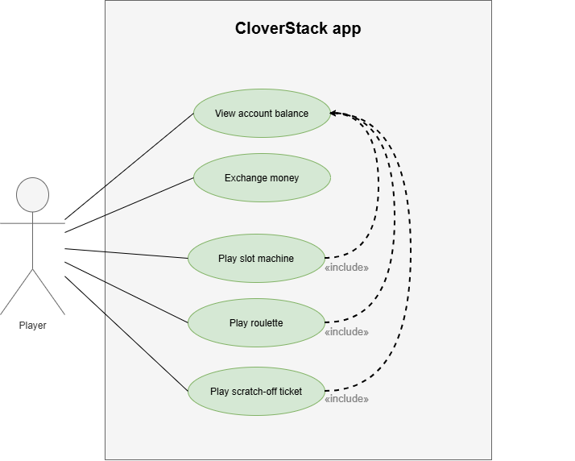

# CloverStack — Software Requirements Specification

<!--
HOW TO USE THIS TEMPLATE
- Copy the whole docs/ folder into your repository.
- Replace every [placeholder] in square brackets. Comments like this one are guidance: they
  are invisible on GitHub, and you may delete them once a section is done.
- Keep every heading and its number. If a section does not apply, write
  "Not applicable" and one sentence why.
- Every section you write names its author: in the "Author" line below its heading, or in
  the Author column of a table. Prefilled sections need no author.
- Structure after the RUP template "Software Requirements Specification":
  https://cin.ufpe.br/~if682/RUP/webtmpl/templates/req/rup_srs.htm
-->

| Team | Version | Last change |
| ---- | ------- | ----------- |
| CloverStack| 0.1 | 12.10.2026 |
The Git history of this file is the revision history.
## Table of contents
1. [Introduction](#1-introduction)
2. [Overall description](#2-overall-description)
3. [Specific requirements](#3-specific-requirements)
4. [Supporting information](#4-supporting-information)
## 1 Introduction
### 1.1 Purpose
*Author: Miriam*
This document specifies the requirements of CloverStack, a casino-style web application in which players use virtual chips to play slot machine, roulette games and scratch-off tickets. It is written for the development team, for the lecturer and for anyone interested.
### 1.2 Scope
*Author: Adolfo*
CloverStack is an entertainment web application for players who are casino fans. Players manage a balance of virtual chips, exchange money for chips, and play several casino games. No real-money will be used and the only actor of the application is the player.

*Author: Adam*

| In scope                                    | Reason                                      |
| ------------------------------------------- | ------------------------------------------- |
| Balance management                          | Allows the player to play games             |
| Money exchange                              | Players need chips to play                  |
| Place bet / buy scratch-off ticket          | Allows the game to start                    |
| Play slot machine                           | Played to win chips                         |
| Play roulette                               | Played to win chips                         |
| Play scratch-off ticket                     | Played to win money                         |
| Persistent storage of accounts and balances | Balances must survive restarts and failures |

| Out of scope                     | Reason                                              |
| -------------------------------- | --------------------------------------------------- |
| Real-money payments              | Legal and security effort too high for this project |
| Multiplayer tables               | Too complex.                                        |
| Implementation on mobile devices | Focus on web applications                           |
### 1.3 Definitions, acronyms and abbreviations
*Author: Adam*

| Term | Meaning                                                        |
| ---- | -------------------------------------------------------------- |
| SRS  | Software Requirements Specification                            |
| UC   | Use case                                                       |
| US   | User Story                                                     |
| NFR  | Non-functional requirement (quality requirement or constraint) |
| TBD  | to be determined                                               |
### 1.4 References
*Author: Miriam*

| Title      | Link                                                                                                               |
| ---------- | ------------------------------------------------------------------------------------------------------------------ |
| Blog       | [https://github.com/deadbeef-alo/CloverStack/discussions](https://github.com/deadbeef-alo/CloverStack/discussions) |
| Board      | [https://github.com/users/deadbeef-alo/projects/1](https://github.com/users/deadbeef-alo/projects/1)               |
| Repository | [https://github.com/deadbeef-alo/CloverStack](https://github.com/deadbeef-alo/CloverStack)                         |
### 1.5 Overview
Section 2 describes the product as a whole: vision and use case diagram. Section 3 lists the
specific requirements: the use cases (3.1) and the quality requirements and constraints
(3.2 to 3.12).
## 2 Overall description
### 2.1 Vision
*Author: Miriam*
In contrast to commercial gambling sites, CloverStack is built for entertainment only. CloverStack allows players to enjoy the games slot machines, roulette and scratch-off tickets without risking their actual money. Players can then trade money to chips. Just like in a normal casino, but only with virtual money.
### 2.2 Use case diagram
*Author: Adolfo*

### 2.3 Assumptions and dependencies
None
## 3 Specific requirements
### 3.1 Functionality
#### 3.1.1 UC-01_view_account_balance
*Author: Adolfo* · The player views its current balance · [Specifications](use_cases/UC-01_view_account_balance.md)
#### 3.1.2 UC-02_Exchange_Money
*Author: Adam* · The player exchanges money for chips. · [Specifications](use_cases/UC-02_ExchangeMoney.md)
#### 3.1.3 UC-03_play-slot-machine
*Author: Miriam* · The player plays a round on the slot machine. · [Specifications](use_cases/UC-03_play-slot-machine.md)
#### 3.1.4 UC-04_play_roulette
*Author: Adolfo* · The player plays a round of roulette · [Specifications](use_cases/UC-04_play_roulette.md)
#### 3.1.5 UC-05_play_Scratch_off_Ticket
*Author: Adam* · The player scratches the ticket.  · [Specifications](use_cases/UC-05_play_Scratch_off_Ticket.md)

<!-- QUALITY REQUIREMENTS (3.2 to 3.5)
     At least one per section. Each one: an ID, one sentence with "shall", a number you can
     test, and if possible stimulus, response and measure. IDs are unique in the whole SRS,
     including the special requirements of your use cases.
     Example: NFR-P-01 — When 50 users search at the same time, the app lists free slots
     within 1 s for 95 % of the requests. -->
### 3.2 Usability

| ID       | Requirement                                                                          | Author |
| -------- | ------------------------------------------------------------------------------------ | ------ |
| NFR-U-01 | Each game mode should include a short tutorial that explains the basics of the game. | Miriam |
### 3.3 Reliability

| ID       | Requirement                                                                                                                                           | Author |
| -------- | ----------------------------------------------------------------------------------------------------------------------------------------------------- | ------ |
| NFR-R-01 | The bet, result, and payout for each round shall be stored together, ensuring that a system failure never results in an inconsistent account balance. | Miriam |
### 3.4 Performance

| ID       | Requirement                                                                                  | Author |
| -------- | -------------------------------------------------------------------------------------------- | ------ |
| NFR-P-01 | The account balance should be displayed in every section of the application within 1 second. | Adolfo |
### 3.5 Supportability

| ID       | Requirement                                                                                                                         | Author |
| -------- | ----------------------------------------------------------------------------------------------------------------------------------- | ------ |
| NFR-S-01 | The application shall run in the current versions of Chrome, Firefox and Edge, verified by one manual test per browser per release. | Miriam |
### 3.6 Design constraints
*Author: Miriam*

| ID    | Constraint                              |
| ----- | --------------------------------------- |
| DC-01 | Frontend: Typescript/React              |
| DC-02 | Backend: Typescript/Node.js mit Express |
| DC-03 | Database: SQLite DB                     |
### 3.7 Online user documentation and help system requirements
A short setup instructions will be included in the “README.md” file.
### 3.8 Purchased components
Not applicable. No components are purchased; only free components will be used.
### 3.9 Interfaces
#### 3.9.1 User interfaces
UC-01_view_account_balance:

UC-02_exchange_money:

UC-04_play_roulette:

#### 3.9.2 Hardware interfaces
Not applicable. The application runs in a web browser and uses no special hardware.
#### 3.9.3 Software interfaces
Not applicable.
#### 3.9.4 Communications interfaces
Not applicable.
### 3.10 Licensing requirements
Not applicable. This is a project for the software engineering module at the DHBW Karlsruhe. 
### 3.11 Legal, copyright and other notices
Not applicable. This is a project for the software engineering module at the DHBW Karlsruhe.
### 3.12 Applicable standards
Not applicable. This is a project for the software engineering module at the DHBW Karlsruhe.
## 4 Supporting information
None.
