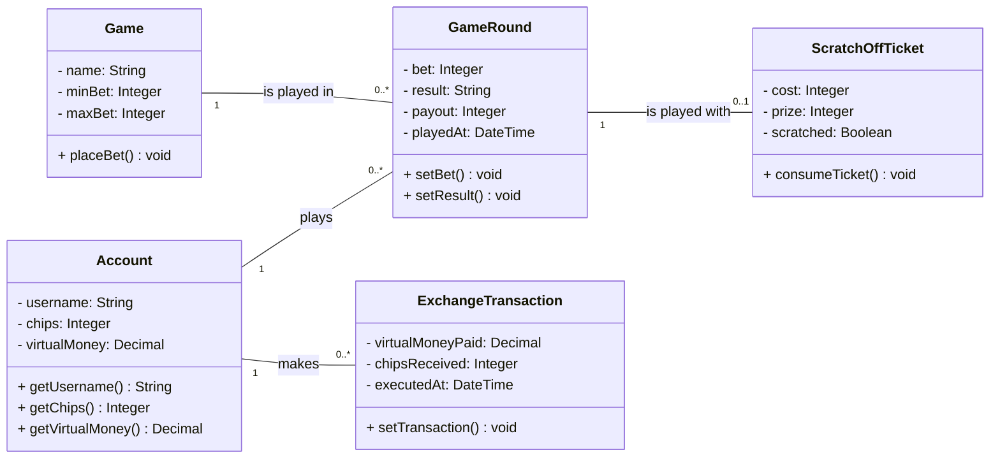

# Domain model
| Authors | Miriam, Adolfo |
| ------- | -------------- |
<!-- One class diagram for the whole application. Commit the source file
next to the image. -->

## Classes
| Class | Meaning |
| ----- | ------- |
| Account | The account of a player. It holds the player's chips and virtual money. |
| Game | One of the games (slot machine, roulette, scratch-off ticket) with the range of bets that is allowed. |
| GameRound | One finished round that an account played in a game. Bet, result, and payout are stored together (NFR-R-01). |
| ScratchOffTicket | A scratch-off ticket with its cost and prize, and whether it was already scratched (UC-05). It is played in one round. |
| ExchangeTransaction | One exchange of virtual money for chips that an account made (UC-02). |
