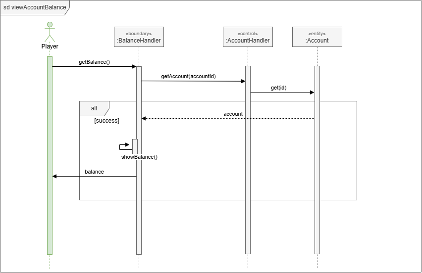

# UCR-01 View account balance — Use-Case Realization
| Author | Realizes |
| ------ | -------- |
| Adolfo | [UC-01 View account balance](../use_cases/UC-01_View_account_balance.md) |

## 1 Introduction
Like above mentioned, this realizes [UC-01 View account balance](../use_cases/UC-01_View_account_balance.md) and covers it entirely. Introduces BalanceHandler, PlayerHandler and Player.

## 2 Flow of events — design

### 2.1 Participating objects
| Object | Stereotype | Responsibility |
| ------ | ---------- | -------------- |
| [:BalanceHandler] | boundary | Shows balance of current player through its id |
| [:PlayerHandler] | control | Processes requests and returns player entity  |
| [:Player] | entity | Stores data of the player |

### 2.2 Sequence diagrams

### 2.3 Walkthrough
- The `getBalance()` function from `[:BalanceHandler]` starts the sequence by requesting player data through `getPlayer(playerId)` from `[:PlayerHandler]` (UC-01 Steps: 1, 2).

- The database will return requested player through `get(id)` and `[:BalanceHandler]` displays player's balance with `showBalance()`(UC-01 Steps: 3, 4).

- Finally, the player will receive `balance` from `[:BalanceHandler]`.

### 2.4 State machine
Not applicable.

## 3 Derived requirements
None.