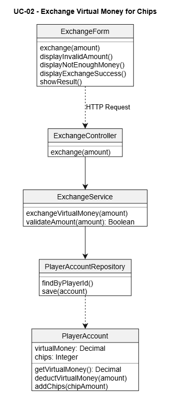
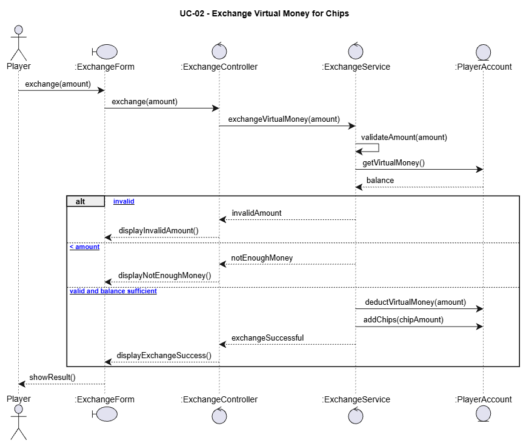

# UCR-02 Exchange Virtual Money for Chips — Use-Case Realization

| Author | Realizes |
| ------ | -------- |
| [Adam] | [UC-02 Exchange Virtual Money for Chips](../use_cases/UC-02_ExchangeMoney.md) |

## 1 Introduction

This use-case realization describes how the player exchanges virtual money for chips. It covers the basic flow and the alternative flow in which the player does not have enough virtual money or enters an invalid amount. The realization focuses on the interactions between boundary, control, and entity objects.

## 2 Flow of events — design

### 2.1 Participating objects

| Object | Stereotype | Responsibility |
| ------ | ---------- | -------------- |
| `:ExchangeForm` | boundary | Receives the exchange amount from the player and displays the result. |
| `:ExchangeMoney` | control | Validates the amount, coordinates the exchange, and updates the player's balances. |
| `:PlayerAccount` | entity | Stores the player's virtual money and chip balance. |

### 2.2 Sequence diagrams

The sequence diagram source file should be saved next to the image.

### 2.3 Walkthrough

1. The player enters an amount to exchange through `:ExchangeForm`.
2. `:ExchangeForm` sends the requested amount to `:ExchangeMoney`.
3. `:ExchangeMoney` validates the amount and requests the current balance from `:PlayerAccount`.
4. If the amount is valid and the player has enough virtual money, `:ExchangeMoney` deducts the virtual money and adds the corresponding chips.
5. `:ExchangeForm` displays the result. If the amount is invalid or the player has insufficient funds, the player is informed and the balances remain unchanged.

### 2.4 State machine

Not applicable.

### 2.5 Design classes

| Analysis object (2.1) | Design class(es) |
| --------------------- | ---------------- |
| `:ExchangeForm «boundary»` | `ExchangePage`, `ExchangeController` |
| `:ExchangeMoney «control»` | `ExchangeService` |
| `:PlayerAccount «entity»` | `PlayerAccount` |

## 3 Derived requirements

- DR-02-01 — The exchange amount must be positive and valid.
- DR-02-02 — The player must have enough virtual money to complete the exchange.
- DR-02-03 — The virtual money and chip balances must be updated consistently so that a failed exchange cannot change only one balance.