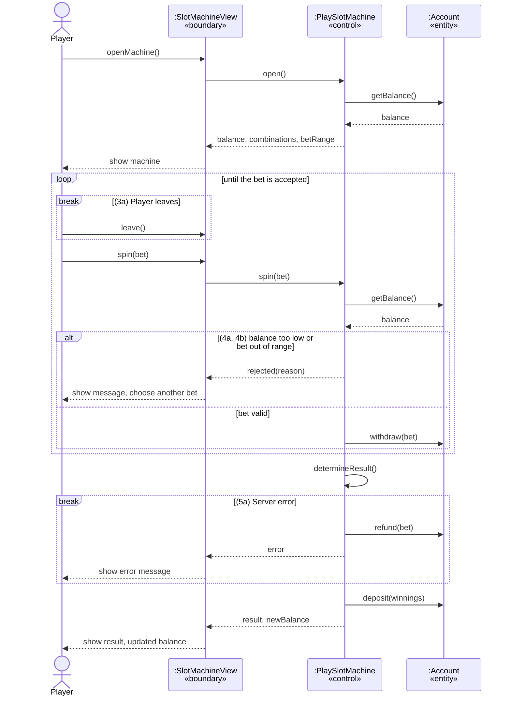

# UCR-03_play-slot-machine — Use-Case Realization

<!--
HOW TO USE THIS TEMPLATE
- Copy this file per realization and name it UCR-[NN]_[name].md, with the number of its
  use case: UCR-02_book_a_room.md realizes UC-02.
- Replace every [placeholder] in square brackets.
- Stay at the analysis level from Lecture 4: boundary, control, and entity objects, no
  framework classes yet. Task 5 replaces them with your design classes.
- Delete these comments once the realization is done.
- Structure after the RUP template "Use-Case Realization Specification":
  https://cin.ufpe.br/~if682/RUP/webtmpl/templates/a_and_d/rup_ucrs.htm
  Section 2 is RUP's "Flow of Events — Design".
-->

| Author | Realizes                                                           |
| ------ | ------------------------------------------------------------------ |
| Miriam | [UC-03_play-slot-machine](../use_cases/UC-03_play-slot-machine.md) |
Use Case: [UC-03](../use_cases/UC-03_play-slot-machine.md)
## 1 Introduction
This realization shows how the use case UC-03 Play slot machine is carried out inside the system: which objects take part and in which order they work together. It covers the basic flow (steps 1–8) and all alternative flows (3a, 4a, 4b, 5a). The balance display itself is taken over from UC-01 and is not detailed here.
## 2 Flow of events — design
### 2.1 Participating objects

| Object           | Stereotype | Responsibility                                                                                                                                                                           |
| ---------------- | ---------- | ---------------------------------------------------------------------------------------------------------------------------------------------------------------------------------------- |
| :SlotMachineView | boundary   | Shows the machine, the balance and the winning combinations; takes the bet and the spin from the player; shows the result, the updated balance and all messages (rejected bet, error)    |
| :PlaySlotMachine | control    | Coordinates the round: checks the bet against balance and allowed range, withdraws the bet, determines the result of the spin, credits the winnings or refunds the bet on a server error |
| :Account         | entity     | Stores the player's chip balance; withdraws, deposits and refunds chips                                                                                                                  |
### 2.2 Sequence diagrams

### 2.3 Walkthrough

<!-- Walk through the diagrams in a few sentences: which object does what, in which order,
     and how the diagrams fit together. Refer to the steps of the use case (1, 2, 4a …). -->

[…]

### 2.4 State machine
Not applicable. ":Account" only holds a balance, not a status with rules.
## 3 Derived requirements

<!-- Requirements the design adds and the implementation must handle, each with an ID that is
     unique in the whole SRS, e.g.,
     DR-02-01 — The slot check and the insert of the booking run in one transaction.
     DR-02-02 — The e-mails are sent asynchronously; a failed send is retried three times.
     Write "None" if there are none. -->

- [DR-NN-01 — …]