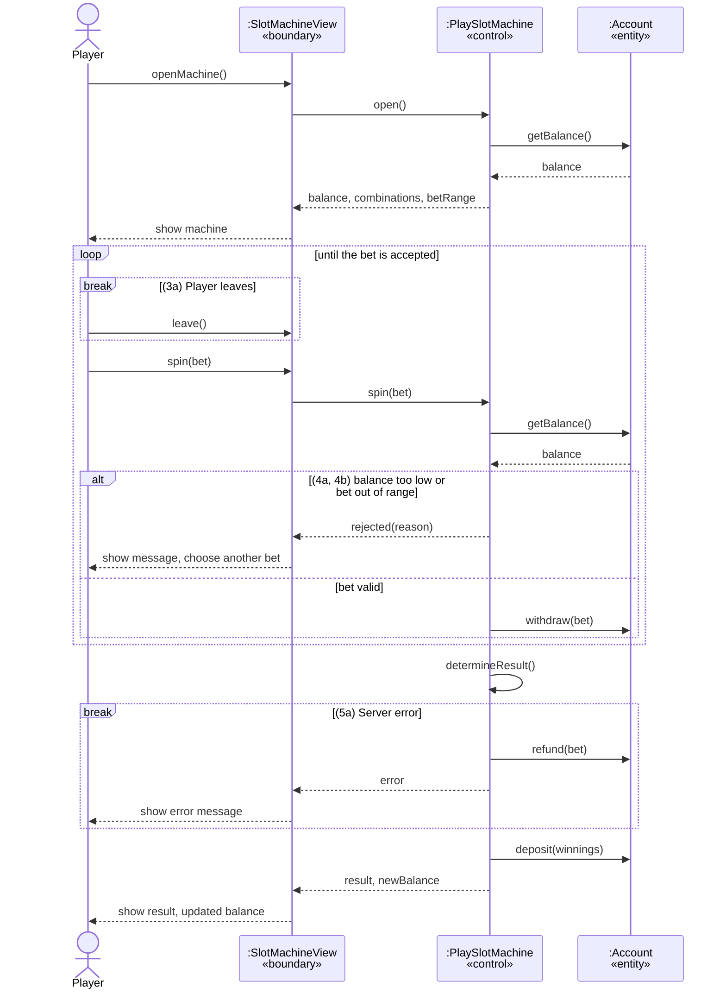

# UCR-03_play-slot-machine — Use-Case Realization

| Author | Realizes                                                           |
| ------ | ------------------------------------------------------------------ |
| Miriam | [UC-03_play-slot-machine](../use_cases/UC-03_play-slot-machine.md) |
## 1 Introduction
This realization shows how the use case UC-03 Play slot machine is carried out inside the system: which objects take part and in which order they work together. It covers the basic flow (steps 1–8) and all alternative flows (3a, 4a, 4b, 5a). The balance display itself is taken over from UC-01 and is not detailed here.
## 2 Flow of events — design
### 2.1 Participating objects

| Object           | Stereotype | Responsibility                                                                                                                                                                           |
| ---------------- | ---------- | ---------------------------------------------------------------------------------------------------------------------------------------------------------------------------------------- |
| :SlotMachineView | boundary   | Shows the machine, the balance and the winning combinations; takes the bet and the spin from the player; shows the result, the updated balance and all messages (rejected bet, error)    |
| :PlaySlotMachine | control    | Coordinates the round: checks the bet against balance and allowed range, withdraws the bet, determines the result of the spin, credits the winnings or refunds the bet on a server error |
| :Account         | entity     | Stores the player's chip balance; withdraws, deposits and refunds chips                                                                                                                  |
### 2.2 Sequence diagrams

### 2.3 Walkthrough
The player opens the slot machine (1). `:SlotMachineView` asks `:PlaySlotMachine` for the data, which reads the balance from `:Account`. The view shows the balance, the winning combinations and the allowed bet range (2).

The player chooses a bet and spins (3). If the player leaves instead, the use case ends and nothing is withdrawn (3a). Otherwise the control checks the bet (4). If the balance is too low (4a) or the bet is out of range (4b), the view shows the reason and the player chooses another bet (back to step 3). If the bet is valid, the control withdraws it from `:Account`.

The control then determines the result (5). If a server error occurs, it refunds the bet, the view shows an error message, and the use case ends (5a). Otherwise the control credits the winnings (6), and the view shows the result and the new balance (7). The player can then play another round or leave (8).
### 2.4 State machine
Not applicable. ":Account" only holds a balance, not a status with rules.
## 3 Derived requirements
- DR-03-01 - The result of a spin is determined in the backend only.
- DR-03-02 - The balance check and the withdrawal of the bet run in one transaction.