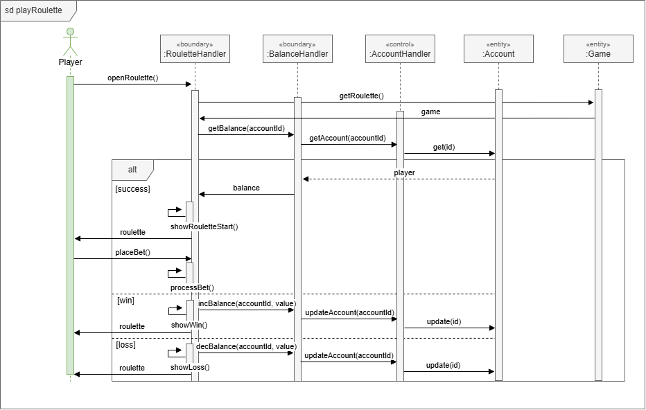

# UCR-04 Play roulette — Use-Case Realization
| Author | Realizes |
| ------ | -------- |
| Adolfo | [UC-04 Play roulette](../use_cases/UC-04_Play_roulette.md) |

## 1 Introduction
Like above mentioned, this realizes [UC-04 Play roulette](../use_cases/UC-04_Play_roulette.md) and covers it entirely. Introduces RouletteHandler and Game.

## 2 Flow of events — design

### 2.1 Participating objects
| Object | Stereotype | Responsibility |
| ------ | ---------- | -------------- |
| [:RouletteHandler] | boundary | Shows game and requests game entity |
| [:BalanceHandler] | boundary | Shows and manages balance of current player through its id |
| [:PlayerHandler] | control | Processes requests and returns player entity  |
| [:Player] | entity | Stores data of the player |
| [:Game] | entity | Stores data of the game |

### 2.2 Sequence diagrams

### 2.3 Walkthrough
- The `openRoulette()` function from `[:RouletteHandler]` starts the sequence by requesting game data through `getRoulette()` from `[:Game]` (UC-04 Steps: 1).

- The `[:RouletteHandler]` requests player data through `getPlayer(playerId)` from `[:PlayerHandler]` and the database will return requested player through `get(id)`. Now `[:RouletteHandler]` receives the balance from `[:BalanceHandler]` (UC-04 Steps: 2, 3).

- With the balance, the `[:BalanceHandler]` can show information and possible bets through `showRouletteStart()` (UC-04 Steps: 4).

- If the player wants to, a bet will be placed and the game will start through `placeBet()` (UC-04 Steps: 5, 6)

- Now `[:BalanceHandler]` will process the bet and decide the outcome through with `processBet()`
(UC-04 Steps: 7).

- If player wins, `[:BalanceHandler]` will show the result and increase player's balance using `showWin()`, `incBalance(playerId, value)`... (UC-04 Steps: 7a, 8).

- If player loses, `[:BalanceHandler]` will show the result and decrease player's balance using `showLoss()`, `decBalance(playerId, value)`... (UC-04 Steps: 7b, 8).

### 2.4 State machine
Not applicable.

## 3 Derived requirements
None.