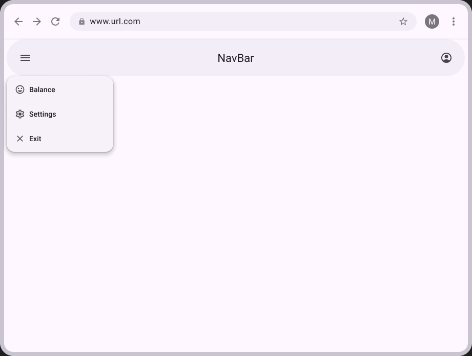
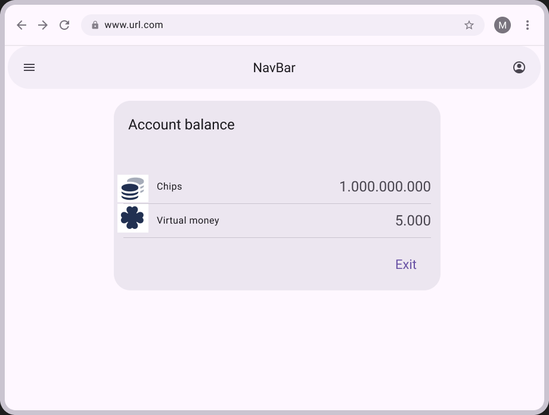
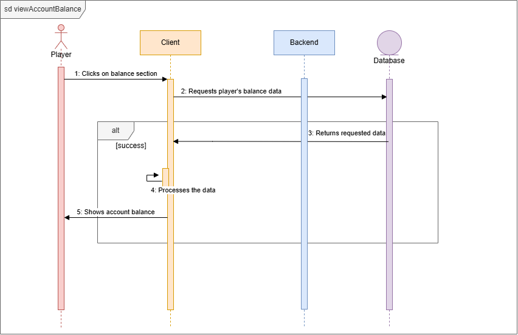
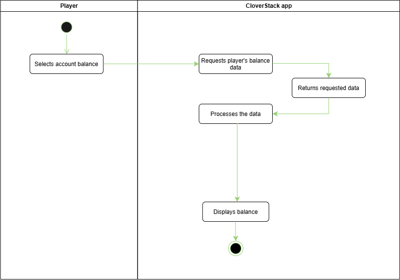

# UC-01 View account balance
| Author | Estimate | User stories |
| ------ | -------- | ------------ |
| Adolfo | 5        | [#9](https://github.com/deadbeef-alo/CloverStack/issues/9) |

 
Realization: [UCR-01](../use_case_realizations/UCR-01_view_account_balance)

## 1 Brief description
This feature allows the user to view its current balance of virtual money and chips. It should be accessible from every menu and show the important information clearly.
## 2 Actors
- **Primary:** Player
- **Secondary:** Client, Backend, Database
## 3 Mockup

## 4 Flow of events
### 4.1 Basic flow

<!-- The success case, 3 to 9 numbered steps (Cockburn). Actor and system take turns. -->

1. The player clicks on account balance section.
2. The client requests player's balance data through backend.
3. The database receives request and returns requested data through backend.
4. The client processes the data.
5. The player is now able to view its account balance.

### 4.2 Alternative flows
n/a

### 4.3 Sequence diagram

### 4.4 Activity diagram

## 5 Special requirements
n/a

## 6 Preconditions
1. The player is logged in.

## 7 Postconditions
n/a

## 8 Estimate
5 story points.