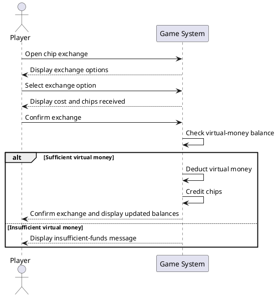

# UC-02: Exchange Virtual Money for Chips

## 1. Brief Description
This use case describes how a player exchanges virtual money for chips in order to play games that require chips.

## 2. Actors
- **Primary Actor:** Player
- **Supporting System:** Game System

## 3. Preconditions
- The player is logged in.
- The player has a sufficient virtual-money balance.
- The chip exchange service is available.

## 4. Basic Flow
1. The player opens the chip exchange section.
2. The system displays the available exchange options and their costs.
3. The player selects an exchange option.
4. The system displays the amount of virtual money required and the number of chips to be received.
5. The player confirms the exchange.
6. The system checks whether the player has sufficient virtual money.
7. The system deducts the required amount of virtual money.
8. The system credits the corresponding number of chips to the player's balance.
9. The system displays a confirmation and the updated balances.
10. The use case ends.

## 5. Alternative Flows

### A1: Insufficient Virtual Money
- At step 6, the system detects that the player does not have enough virtual money.
- The system displays an insufficient-funds message.
- No virtual money is deducted and no chips are credited.
- The player can select a cheaper exchange option or cancel the transaction.
- The use case ends or resumes at step 2.

### A2: Player Cancels the Exchange
- Before confirming the exchange at step 5, the player cancels the transaction.
- The system returns to the exchange options.
- Neither balance is changed.
- The use case ends.

### A3: Exchange Processing Error
- During steps 7 or 8, the system encounters an error.
- The system ensures that the transaction does not leave the balances inconsistent.
- The system informs the player that the exchange could not be completed.
- The use case ends.

## 6. Special Requirements
- The system must use clearly defined exchange rates.
- The transaction must update both balances consistently.
- The system must prevent duplicate transactions.
- The system must prevent negative virtual-money or chip balances.
- The system must display a confirmation after a successful exchange.

## 7. Postconditions
**Success:**
- The required virtual money has been deducted.
- The corresponding chips have been credited.
- The updated balances are displayed to the player.

**Failure:**
- If the exchange fails or is cancelled, no balance changes are applied.
- The player's balances remain consistent.

## 8. Story Points
**Estimated Effort:** 5 Story Points

## 9. Sequence Diagram

