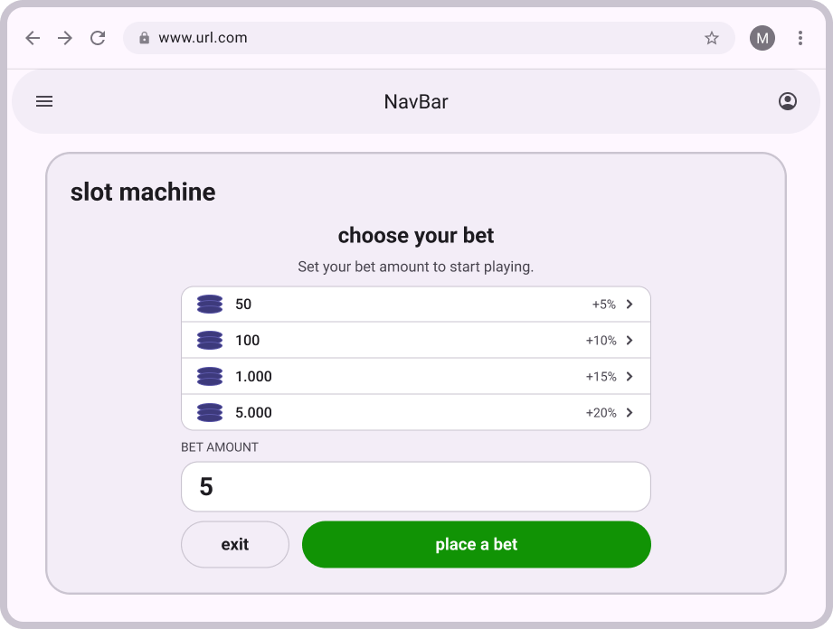
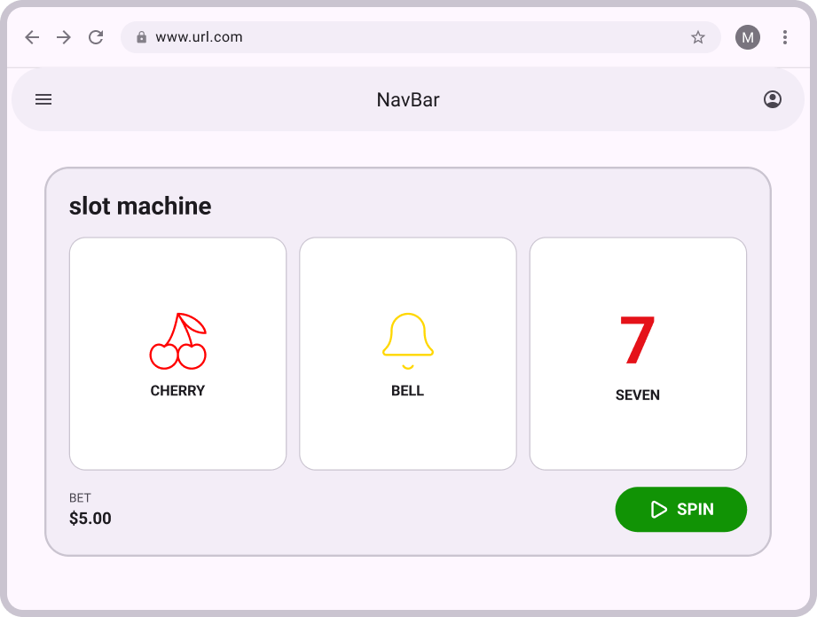
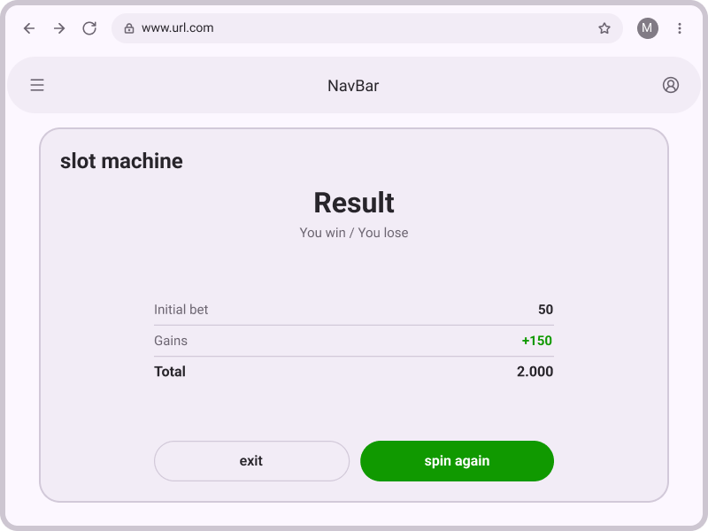
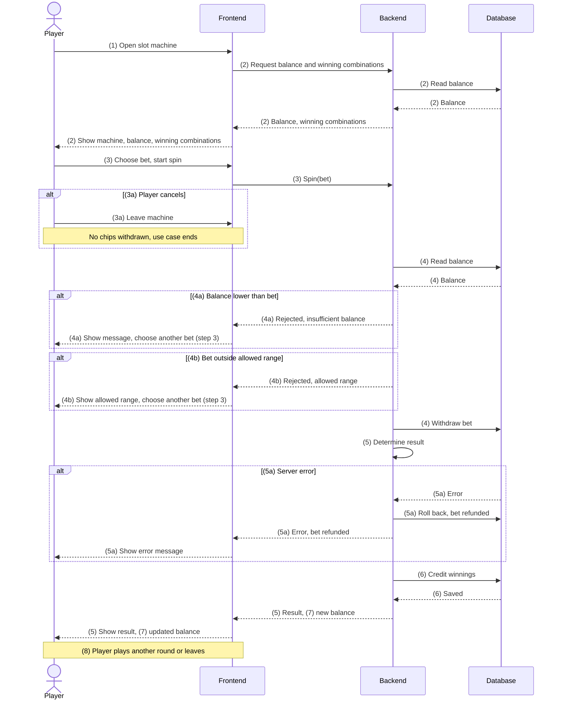

# UC-03_Play-slot-machine

| Author | Estimate | User stories                                                 |
| ------ | -------- | ------------------------------------------------------------ |
| Miriam | 13       | [#25](https://github.com/deadbeef-alo/CloverStack/issues/25) |

Realization: [UCR-03](../use_case_realizations/UCR-03_play-slot-machine.md)
## 1 Brief description

The player plays a round on the slot machine. They choose a bet, spin, and see the result. Winnings are paid out in chips to their account balance. The use case lets the player try their luck with chips from their balance and gives them a clear result for every round.

## 2 Actors

- **Primary:** Player
- **Secondary:** none

## 3 Mockup

## 4 Flow of events

### 4.1 Basic flow

1. The player opens the slot machine.
2. The system shows the machine together with the player's current balance [UC-01_view_account_balance](use_cases/UC-01_view_account_balance) and a display showing the winning combinations.
3. The player chooses a bet amount and starts the spin.
4. The system checks whether the balance covers the bet and withdraws the bet amount from the balance.
5. The system determines the result of the spin and shows it to the player.
6. The system credits any winnings to the balance.
7. The player sees the updated balance.
8. The player can decide whether to play another round or leave the machine.

### 4.2 Alternative flows

- 3a - Player cancels: After step 3, the player leaves the machine without spinning. No chips are withdrawn. The use case ends.
- 4a - Players Balance is to low: The system determined that the balance doesn't cover the bet. The spin is canceled. The player can choose a different bet and start a new spin. The flow continues at step 3.
- 4b - Bet outside the allowed range: The system determined that the players bet ist to low or to high. The system rejects the bet and shows the allowed range. The flow continues at step 3.
- 5a - Server error: The connection is lost or the server fails before the winnings are paid out. The system does not keep the bet as lost: the bet is refunded. The use case ends.

### 4.3 Sequence diagram

### 4.4 Activity diagram

```mermaid
flowchart TB
    S((" ")):::init

    subgraph System
        direction TB
        B["Show machine, balance<br/>and winning combinations"]
        M{" "}
        D3{"Bet within allowed range?"}
        R1["Show insufficient-balance message"]
        R2["Reject bet and show allowed range"]
        W["Withdraw bet from balance"]
        F["Determine result of spin"]
        G{"Server error before<br/>payout?"}
        H["Refund bet"]
        I["Show error message"]
        J["Credit winnings to balance"]
        N["Show result of spin"]
        O["Show updated balance"]
        END2((" ")):::final
    end

    subgraph Player
        direction TB
        A["Open slot machine"]
        C["Choose bet amount"]
        D{"Player leaves?"}
        L1["Leave machine<br/>(no chips withdrawn)"]
        E["Start spin"]
        P["See updated balance"]
        Q{"Play another round?"}
        L2["Leave machine"]
	    END1((" ")):::final
	    END3((" ")):::final    
    end

    S --> A --> B --> M
    M --> C --> D
    D -- "[cancel]" --> L1 --> END1
    D -- "[spin]" --> E --> D3
    D3 -- "[balance too low]" --> R1 --> M
    
    D3 -- "[out of range]" --> R2 --> M
    D3 -- "[valid bet]" --> W --> F --> G
    G -- "[server error]" --> H --> I --> END2
    G -- "[else]" --> N --> J --> O --> P --> Q
    Q -- "[play again]" --> M
    Q -- "[leave]" --> L2 --> END3
    
    classDef init fill:#000,stroke:#000 
    classDef final fill:#fff,stroke:#000,stroke-width:4px
```

## 5 Special requirements
- NFR-R-01 - The bet, result, and payout for each round shall be stored together, ensuring that a system failure never results in an inconsistent account balance.
## 6 Preconditions
- The player is logged in.
- The slot machine is available.
## 7 Postconditions
- The player's balance includes the bet and any winnings.