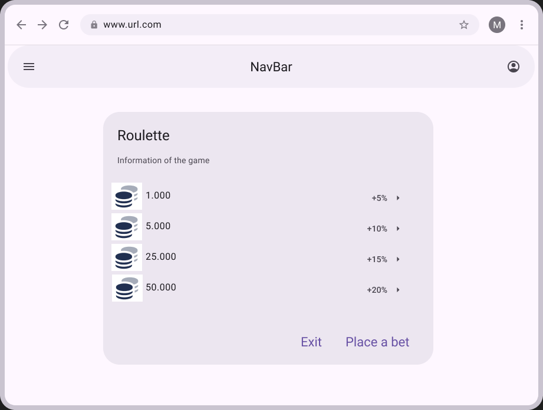
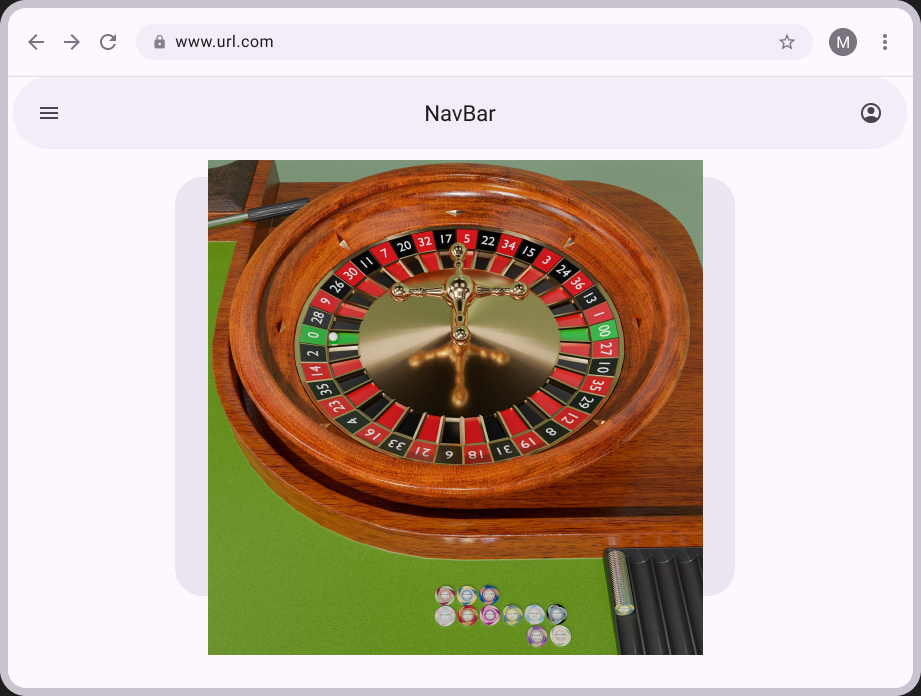
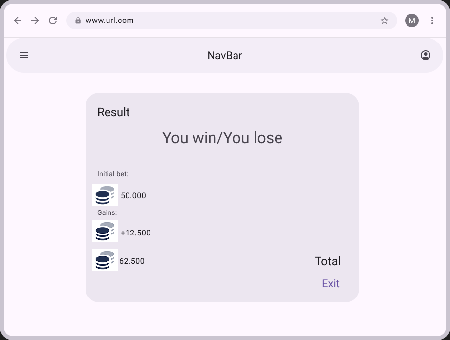
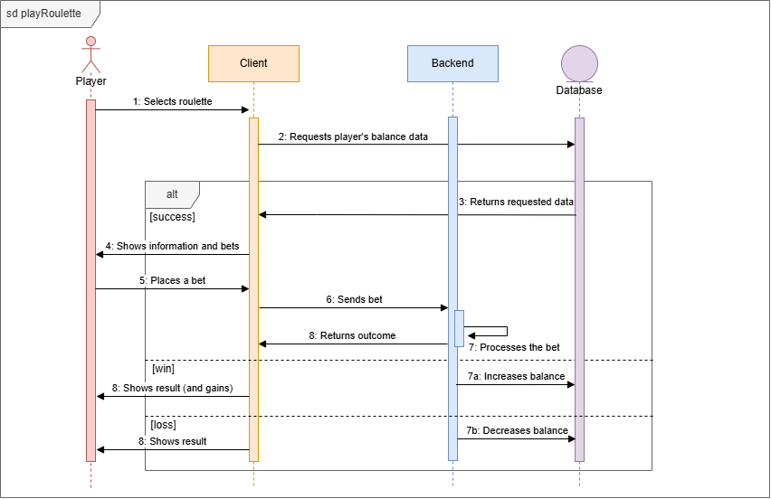
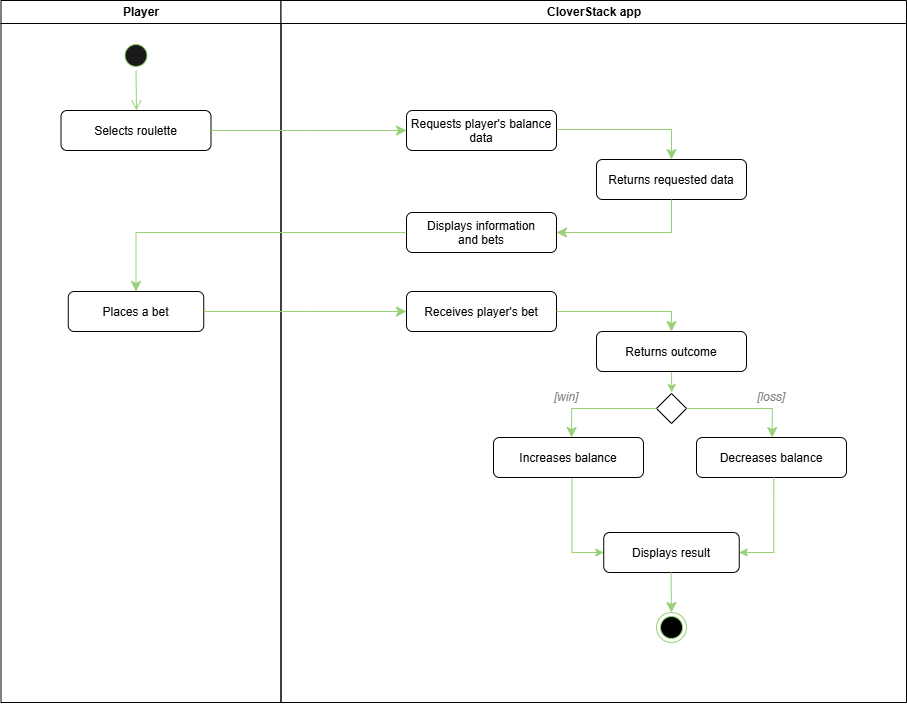

# UC-04 Play roulette
| Author | Estimate | User stories |
| ------ | -------- | ------------ |
| Adolfo | 13        | [#23](https://github.com/deadbeef-alo/CloverStack/issues/23) |

<!-- [#12, #13 — and write "Implements UC-NN" into each of these issues] -->

## 1 Brief description
This feature allows the player to play roulette and place a bet, which in case of winning should give the player chips.

## 2 Actors

- **Primary:** Player
- **Secondary:** Client, Backend, Database

## 3 Mockup

## 4 Flow of events
### 4.1 Basic flow

<!-- The success case, 3 to 9 numbered steps (Cockburn). Actor and system take turns. -->

1. The player selects roulette from the selection menu.
2. The client requests player's balance data through backend.
3. The database receives request and returns requested data through backend.
4. The client shows information about the game and possible bets.
5. The player places a bet and starts the game.
6. The client sends player bet.
7. The backend processes the bet and returns guess outcome.
8. The client receives the response and shows the result.

### 4.2 Alternative flows
**7a · Win.**   At step 7, if guess was correct. The backend increases player's balance. The flow continues at step 8.

**7b · Loss.**   At step 7, if guess was incorrect. The backend decreases player's balance. The flow continues at step 8.

### 4.3 Sequence diagram

### 4.4 Activity diagram

## 5 Special requirements
n/a

## 6 Preconditions
1. The player is logged in.

## 7 Postconditions
1. The player's account balance will increased/decreased

## 8 Estimate
13 story points.