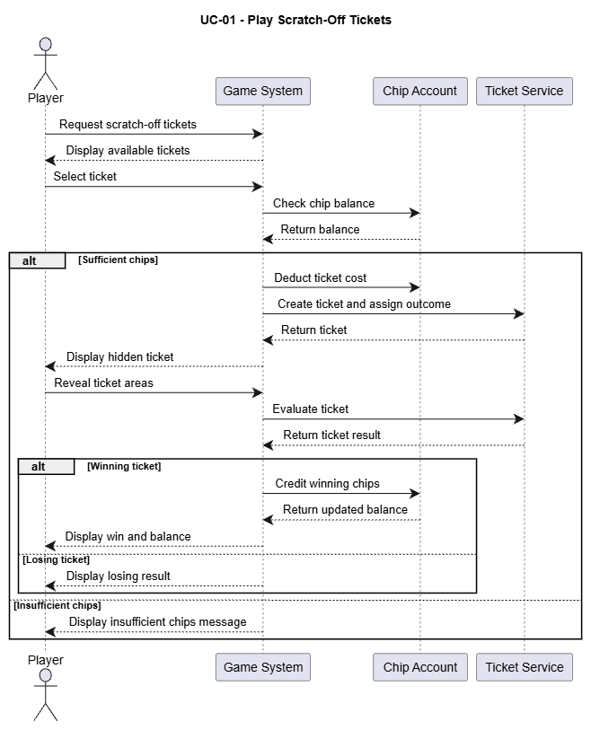

# UC-01: Play Scratch-Off Tickets

## 1. Brief Description
This use case describes how a player plays a scratch-off ticket to win chips.

## 2. Actors
- **Primary Actor:** Player
- **Supporting System:** Game System

## 3. Preconditions
- The player is logged in.
- The player has enough chips to purchase a scratch-off ticket.
- Scratch-off tickets are available.

## 4. Basic Flow
1. The player opens the scratch-off ticket section.
2. The system displays the available scratch-off tickets and their costs.
3. The player selects a scratch-off ticket.
4. The system checks whether the player has enough chips.
5. The system deducts the ticket cost from the player's chip balance.
6. The system displays the selected scratch-off ticket.
7. The player scratches off the covered areas.
8. The system evaluates the revealed symbols or numbers.
9. The system determines whether the player has won.
10. If the player wins, the system credits the corresponding prize in chips.
11. The system displays the result and the updated chip balance.
12. The use case ends.

## 5. Alternative Flows

### A1: Insufficient Chips
- At step 4, the system detects that the player does not have enough chips.
- The system displays an insufficient-chips message.
- The player can return to the ticket selection or exchange virtual money for chips.
- The use case ends or resumes after the player obtains enough chips.

### A2: No Prize
- At step 9, the system determines that the ticket is not a winner.
- The system informs the player that no prize has been won.
- The system displays the updated chip balance.
- The use case ends.

### A3: Ticket Unavailable
- At step 3, the selected ticket is no longer available.
- The system informs the player and displays the available tickets again.
- The player can select another ticket.
- The use case resumes at step 2.

## 6. Special Requirements
- The system must calculate results reliably and consistently.
- The chip balance must be updated correctly.
- Each ticket must be evaluated only once.
- The system must clearly display the result and any prize awarded.
- The system must prevent the chip balance from becoming negative.

## 7. Postconditions
**Success:**
- The ticket has been evaluated.
- The ticket cost has been deducted.
- Any prize won has been credited to the player's chip balance.
- The result is displayed to the player.

**Failure:**
- If the player cannot afford the ticket, no chips are deducted.
- If the ticket is unavailable, the player's chip balance remains unchanged.

## 8. Story Points
**Estimated Effort:** 5 Story Points

## 9. Sequence Diagram

